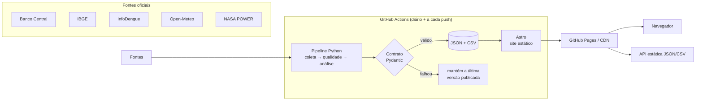

# DataAn — dados públicos do Brasil, explicados em gráficos

[](https://github.com/AknoLeonel/DataAn/actions/workflows/deploy.yml)

Plataforma aberta que coleta dados de fontes oficiais, valida, analisa e publica
visualizações interativas, atualizadas automaticamente todos os dias.

**Site:** https://aknoleonel.github.io/DataAn/ · **API:** [`/data/catalog.json`](https://aknoleonel.github.io/DataAn/data/catalog.json) · **Status:** [`/status/`](https://aknoleonel.github.io/DataAn/status/)

## Conjuntos de dados

| Área | Conjunto | Fonte | O que tem de análise |
|---|---|---|---|
| Economia | Taxa Selic e juro real | Banco Central (SGS) | Juro real ex-post, posição histórica, último movimento do Copom |
| Economia | Inflação (IPCA) | Banco Central (SGS) | Comparação com centro/teto da meta do CMN ano a ano |
| Economia | Dólar comercial | Banco Central (SGS) | Variações 30 d / 12 m, histórico com amostragem LTTB |
| Economia | Taxa de desemprego | IBGE via SGS | Variação interanual, mínimas e máximas da série |
| Saúde | Dengue nas capitais | InfoDengue (Fiocruz/FGV) | Nowcasting de atraso, **previsão de 4 semanas com backtest** vs. ingênuo |
| Meio ambiente | Qualidade do ar | Open-Meteo (Copernicus CAMS) | PM2.5 vs. diretriz da OMS, ranking e dias acima do limite |
| Clima | Aquecimento nas capitais | NASA POWER (MERRA-2) | Anomalia vs. normal 1991–2020, aquecimento por capital |
| Demografia | População dos estados | IBGE (SIDRA) | Ranking, concentração e crescimento entre estimativas |

## Arquitetura



Decisões e alternativas estão em [`docs/arquitetura.md`](docs/arquitetura.md).

**Destaques técnicos**

- **Contrato de dados único** (`pipelines/dataan/models.py` ↔ `web/src/lib/types.ts`): todo gráfico, KPI e texto passa por validação antes de ir ao ar.
- **Qualidade antes de publicar**: volume mínimo, faixas plausíveis, atraso máximo da fonte, ordem temporal e colunas do CSV iguais às documentadas.
- **Operação resiliente**: retentativa com backoff, falha isolada por dataset, fallback para a última versão publicada e página de status pública com histórico.
- **Estatística honesta**: a previsão de dengue usa Holt amortecido em escala log, validação com origem móvel (só passado → futuro) e é comparada com a previsão ingênua; o intervalo de 80% vem dos erros do próprio backtest. O resultado aparece mesmo quando o modelo perde.
- **Gráficos próprios em SVG**, sem biblioteca: renderizados no build (funcionam sem JS) e redesenhados no navegador com tooltip, crosshair, toque e teclado. A paleta foi validada para daltonismo, com modo escuro próprio e tabela equivalente para cada gráfico.
- **SEO**: HTML estático, `sitemap.xml`, canonical, Open Graph e JSON-LD `Dataset`, elegível ao Google Dataset Search.
- **Segurança**: CSP com hashes (sem `unsafe-inline`), nenhum segredo, Actions com permissões mínimas. Detalhes em [`SECURITY.md`](SECURITY.md).

## Rodando localmente

Requisitos: Python 3.11+ e Node 22.12+.

```bash
make install          # cria .venv, instala o pipeline e o site
make data             # coleta os dados reais -> web/public/data
make dev              # http://localhost:4321
```

Sem `make`:

```bash
python3 -m venv .venv && .venv/bin/pip install -e "pipelines[dev]"
.venv/bin/python -m dataan run                  # todos os datasets
.venv/bin/python -m dataan run --only selic     # só um
cd web && npm install && npm run dev
```

## Adicionar um novo conjunto de dados

Uma função decorada é tudo o que é preciso. O runner descobre, executa, valida, publica e o site cria a página, o card, o sitemap e os metadados de SEO.

```python
# pipelines/dataan/datasets/economia.py
@dataset(
    slug="igpm",
    title="IGP-M",
    summary="O índice que reajusta aluguéis, mês a mês.",
    description="...",
    category="economia",                       # ou crie uma em registry.CATEGORIES
    sources=[_src(189, "IGP-M mensal")],
    frequency="Mensal",
    columns=[Column(name="mes", description="..."), Column(name="igpm", description="...")],
)
def igpm() -> Build:
    s = _monthly(bcb.sgs(189, date(2010, 1, 1)))
    check_series(s, "IGP-M", min_points=60, lo=-10, hi=10, max_age_days=75)
    table = s.rename("igpm").rename_axis("mes").reset_index()
    table["mes"] = table["mes"].dt.strftime("%Y-%m-%d")
    return Build(
        charts=[LineChart(id="historico", title="IGP-M mensal", format=pct(2),
                          series=[Series(key="igpm", name="IGP-M", points=to_points(s))])],
        kpis=[Kpi(label="IGP-M do mês", value=float(s.iloc[-1]), format=pct(2))],
        table=table,
    )
```

Fonte nova? Crie um conector em `pipelines/dataan/sources/` usando `http.get_json` (já tem retentativa, timeout e limite de tamanho). Tipos de gráfico disponíveis: `line` (com faixa, referência, marcador e degrau), `bar` (ranking), `column` (divergente) e `grid` (pequenos múltiplos).

## Estrutura

```
pipelines/dataan/
  sources/      conectores das APIs públicas
  datasets/     um módulo por área; cada função @dataset é um conjunto
  analysis/     amostragem (LTTB), previsão + backtest, checagens de qualidade
  models.py     contrato de dados publicado
  runner.py     execução isolada, fallback, catálogo e status
web/src/
  lib/charts/   renderizadores SVG (linha, barra, coluna, sparkline)
  components/   KPI, gráfico, tabela acessível, cards
  pages/        início, dataset, categorias, status, API, sobre
  scripts/      interatividade (tooltip/teclado), busca, tema
.github/workflows/
  deploy.yml    pipeline diário + build + GitHub Pages
  ci.yml        lint, tipos e build em pull requests
```

## Operação

- **Agenda:** todo dia às 06:17 (Brasília), a cada push na `main` e manualmente em *Actions → Pipeline e deploy → Run workflow*.
- **Falhas:** aparecem como aviso no resumo da execução no Actions e na [página de status](https://aknoleonel.github.io/DataAn/status/). O site segue no ar com a última versão válida.
- **Domínio próprio:** configure em *Settings → Pages*; o build usa automaticamente a URL e o caminho corretos.

## Licença

Código sob [MIT](LICENSE). Os dados pertencem às fontes citadas em cada página e seguem suas licenças.
